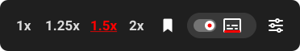
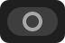

 

# YouTube Channel Memory

A Tampermonkey userscript that remembers **playback speed** and **captions on/off** for each YouTube channel, plus a few quality-of-life extras: start videos paused, fullscreen when you press Play, a thin progress bar while the controls are hidden, audio boost and live-chat hiding.

## Install

1. Install [Tampermonkey](https://www.tampermonkey.net/) in Chrome, Edge or Firefox.
2. Open **[YouTube_Channel_Memory.user.js](https://raw.githubusercontent.com/bgtsai/youtube-channel-memory/main/YouTube_Channel_Memory.user.js)** and click **Install**.
3. Open any YouTube video — the controls appear on the right side of the player bar.

Updates are picked up automatically by Tampermonkey.

## The player bar

From left to right: **speed buttons → bookmark → caption group (pill + caption button) → settings**.

### Speed buttons

Click a speed to apply it. The current speed is highlighted; the speed saved for this channel is <u>underlined</u>. Labels, speeds and colors can be changed in the settings.

### Bookmark — save this channel's defaults

Clicking the bookmark saves the **current speed and current caption state** for the channel. A short fill-up animation plays and a tooltip confirms what was saved.

| Icon | Meaning |
|:---:|---|
|  | No speed saved for this channel yet |
|  | Saved, and what is playing matches it |
|  | Saved, but you changed the speed or captions since — click to update |

A video that simply has no captions does not count as a change.

### Caption group

The rounded group holds two separate controls:

**Caption button** (replaces YouTube's own) — what is happening *now*. Click it to toggle captions; the <kbd>C</kbd> key keeps working.

| Icon | Meaning |
|:---:|---|
|  | Captions on (red segment on the bottom edge) |
|  | Captions off |
|  | This video has no captions |

**Pill switch** — the caption default *saved for the channel*. Clicking it saves immediately and does not change the captions currently shown.

| Pill | Meaning |
|:---:|---|
|  | Saved: captions on |
|  | Saved: captions off |
|  | Nothing saved — YouTube's own behaviour is kept |

### Settings

 opens the settings panel (also available from the Tampermonkey menu → **Settings**).

## Settings

| Section | Option | What it does |
|---|---|---|
| Playback | Default Speed | Speed for channels without a saved speed |
| | Audio Boost | Volume gain with a limiter (1 = off) |
| | Start New Videos Paused | Videos opened in a new tab or by your own click start paused; playlists / autoplay-next keep playing |
| Speed Buttons | Button Templates | Edit, add, remove and reorder the speed buttons |
| | Current / Other Speeds | Text colors of the speed buttons |
| Language | Interface Language | Auto (follow YouTube), English, 繁體中文 or a custom translation |
| Display | Show Relative Time | Shows the current time and duration adjusted for the playback speed |
| | Bottom Progress Bar | A thin progress bar along the bottom whenever the player controls are hidden (normal and fullscreen) |
| | Hide Live Chat | Hides the live-chat panel (the playlist panel is unaffected) |
| Automation | Fullscreen When I Press Play | Enters fullscreen the moment you press Play |
| | Auto Exit Fullscreen on End | Leaves fullscreen 5 seconds before the video ends |

## About auto fullscreen

Browsers only allow a page to enter fullscreen right after you click or press a key. This script therefore enters fullscreen **when you press Play**, which works in Chrome, Edge and Firefox with no extra setup.

> [!IMPORTANT]
> Turn on **Start New Videos Paused** together with it. Every video then starts with your own Play press, so fullscreen always triggers.
>
> Videos that start by themselves (autoplay-next, or with Start Paused off) can only go fullscreen if the browser allows it:
> - **Firefox:** open `about:config` and set `full-screen-api.allow-trusted-requests-only` to `false`.
> - **Chrome / Edge:** add `https://www.youtube.com` to the enterprise policy `AutomaticFullscreenAllowedForUrls`.

## Notes

- Preferences are stored by Tampermonkey (keys starting with `_YSC-`; per-channel values use the channel's `@handle`).
- Collaboration videos credit several channels; saving applies to all of them.
- **Restore Default** in the settings resets every option to its default; custom translations are kept.

## License

[MIT](LICENSE)
