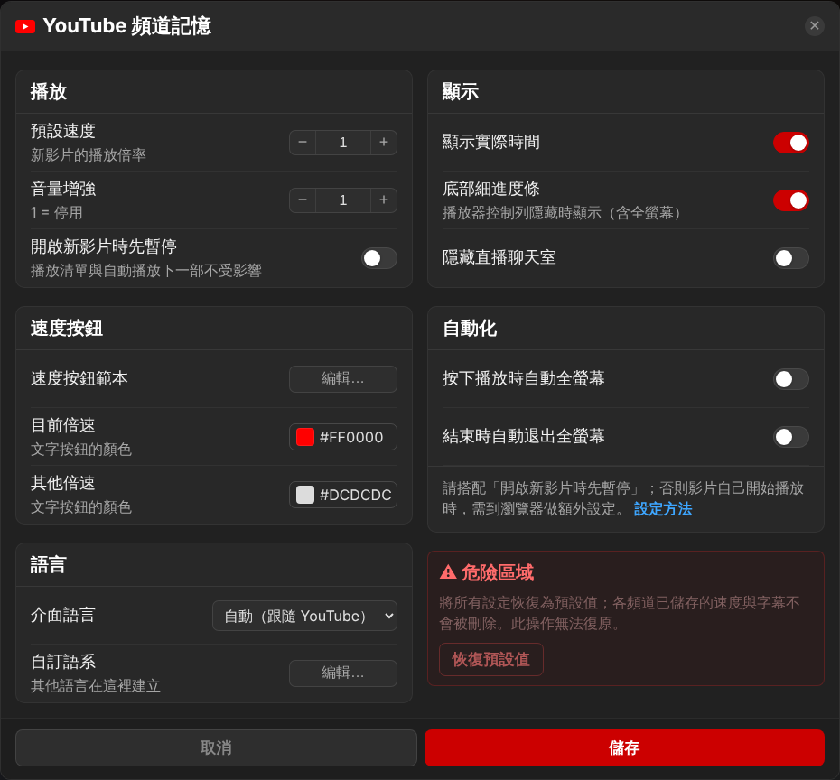

[Switch to English](README.md)

# YouTube 頻道記憶

依 YouTube **頻道**記住**播放速度**與**字幕開關**的 Tampermonkey 腳本，另外附帶幾個實用功能：新開影片先暫停、按下播放即全螢幕、控制列隱藏時的底部細進度條、音量增強、隱藏直播聊天室。

## 安裝

1. 在 Chrome、Edge 或 Firefox 安裝 [Tampermonkey](https://www.tampermonkey.net/)。
2. 打開 **[YouTube_Channel_Memory.user.js](https://raw.githubusercontent.com/bgtsai/youtube-channel-memory/main/YouTube_Channel_Memory.user.js)**，按 **安裝**。
3. 打開任一支 YouTube 影片，播放器控制列右側就會出現本腳本的按鈕。

之後的更新 Tampermonkey 會自動抓取。

## 播放器控制列

由左到右：**速度按鈕 → 書籤 → 字幕組（膠囊＋字幕按鈕）→ 設定**。

### 速度按鈕

點一下就套用該速度。目前的速度會變色；這個頻道存下來的速度會加<u>底線</u>。按鈕文字、速度與顏色都可以在設定裡修改。

### 書籤：儲存這個頻道的預設值

按下書籤，會把**目前的速度與目前的字幕狀態**存成這個頻道的預設值。書籤會播放一段由下往上填滿的動畫，提示框也會顯示這次存了什麼。

| 圖示 | 意思 |
|:---:|---|
|  | 這個頻道還沒存過速度 |
|  | 已存過，而且目前的設定跟存的一致 |
|  | 已存過，但你之後改了速度或字幕；再按一次就會更新 |

影片本身沒有字幕可開時，不算「改了字幕」。

### 字幕組

圓角底框裡是兩個各自獨立的元件：

**字幕按鈕**（取代 YouTube 原生的字幕按鈕）：顯示「現在」的字幕狀態。點一下切換字幕；鍵盤 <kbd>C</kbd> 一樣能用。

| 圖示 | 意思 |
|:---:|---|
|  | 字幕開啟（圖示底邊有一段紅色） |
|  | 字幕關閉 |
|  | 這支影片沒有字幕 |

**膠囊開關**：顯示這個頻道「存下來」的字幕預設值。點一下就立刻儲存，不會改變目前畫面上的字幕。

| 膠囊 | 意思 |
|:---:|---|
|  | 存的是：字幕開 |
|  | 存的是：字幕關 |
|  | 還沒存過，維持 YouTube 原本的行為 |

### 設定

 打開設定面板（也可以從 Tampermonkey 選單 → **設定** 進入）。

## 設定項目

| 區塊 | 項目 | 作用 |
|---|---|---|
| 播放 | 預設速度 | 沒存過速度的頻道使用的速度 |
| | 音量增強 | 放大音量並加上限幅器避免爆音（1 = 停用） |
| | 開啟新影片時先暫停 | 開新分頁或你自己點進去的影片會先暫停；播放清單與自動播放下一部照常接著播 |
| 速度按鈕 | 速度按鈕範本 | 編輯、新增、刪除、排序速度按鈕 |
| | 目前倍速／其他倍速 | 速度按鈕的文字顏色（調色面板可按住上緣把手拖曳） |
| 語言 | 介面語言 | 自動（跟隨 YouTube）、English、繁體中文，或自訂語系 |
| | 自訂語系 | 建立其他語言的翻譯 |
| 顯示 | 顯示實際時間 | 依目前倍速換算後的播放時間與總長度 |
| | 底部細進度條 | 播放器控制列隱藏時，在畫面最下方顯示一條細進度條（一般與全螢幕皆適用） |
| | 隱藏直播聊天室 | 隱藏直播聊天室面板，全螢幕時也不留空白欄（播放清單面板不受影響） |
| 自動化 | 按下播放時自動全螢幕 | 你按下播放的那一刻進入全螢幕 |
| | 結束時自動退出全螢幕 | 影片結束前 5 秒退出全螢幕 |

## 關於自動全螢幕

瀏覽器只允許網頁在你「點擊或按鍵之後」進入全螢幕。所以本腳本在**你按下播放的那一刻**進入全螢幕，Chrome、Edge、Firefox 都不需要額外設定。

> [!IMPORTANT]
> 請一併開啟 **「開啟新影片時先暫停」**。這樣每支影片都由你自己按下播放，全螢幕就一定能觸發。
>
> 自己開始播放的影片（自動播放下一部，或沒開「先暫停」時），必須瀏覽器允許才能全螢幕：
> - **Firefox：**打開 `about:config`，把 `full-screen-api.allow-trusted-requests-only` 設為 `false`。
> - **Chrome／Edge：**在企業政策 `AutomaticFullscreenAllowedForUrls` 加入 `https://www.youtube.com`。

## 其他說明

- 設定由 Tampermonkey 儲存（以 `_YSC-` 開頭；各頻道的值以頻道的 `@handle` 為鍵）。
- 多頻道合作的影片會標出好幾個頻道，儲存時會一併存到每一個頻道。
- 設定裡的「恢復預設值」會把所有選項改回預設；各頻道已儲存的速度與字幕、自訂語系的翻譯資料都會保留。

## 授權

[MIT](LICENSE)
